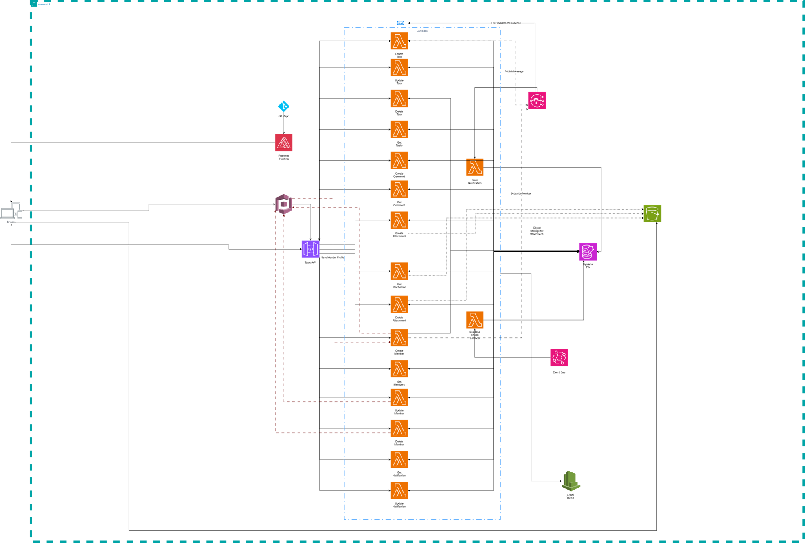

# DOM05-ServerlessLab

Orvia: a serverless task manager on AWS. Admins create and assign tasks, team members work through them, and everyone gets in-app and email notifications.

Open Source Frontend - https://github.com/CodEZ47/Employee-Task-Assigner

## Repository layout

```
backend/functions/       Lambda handlers (Node.js 22, ES modules), zipped as one package by Terraform
  tasks/                 task, comment and attachment-upload handlers
  members/               member handlers and GET /me (members/me.mjs)
  notifications/         in-app notification handlers
  jobs/                  non-HTTP Lambdas: deadline_check (Step Functions), save_notification (SNS)
  shared/                auth, HTTP helpers, DynamoDB/S3/SNS/Step Functions helpers
frontend/                React + Vite app (see frontend/README.md)
infra/
  bootstrap/             S3 bucket for Terraform remote state (run once)
  environments/prod/     root module: wires all modules together
  modules/               auth, storage, functions, api, events
  frontend/              Amplify Hosting app for the frontend
scripts/                 helper scripts: create the first admin, get an API token, curl test requests
Orvia.drawio.svg         architecture diagram
```

## Phase 1
### Requirements

ADM-01: The system shall allow an Admin to create a task with a title, description, priority, deadline, and optional attachment.
ADM-02: The system shall allow an Admin to assign a task to a Team Member.
ADM-03: The system shall allow an Admin to view all tasks, filterable by status, assignee, and deadline.
ADM-04: The system shall allow an Admin to edit or delete any task.
ADM-05: The system shall allow an Admin to create a new Team Member profile using their name and email, and the system shall email them a temporary password via Cognito.
ADM-06: The system shall allow an Admin to view all members, filterable by name, open tasks, and completed tasks.
ADM-07: The system shall allow an Admin to add comments or attachments to tasks.
ADM-08: The system shall allow an Admin to deactivate a Team Member.

TM-01: The system shall show a Team Member only the tasks assigned to them.
TM-02: The system shall allow a Team Member to change a task’s status (New → To Do → In Progress → Completed | In Progress → Blocked → In Progress ).
TM-03: The system shall prevent a Team Member from creating, deleting, or reassigning tasks.
TM-04: The system shall allow a Team Member to add comments or attachments to their assigned tasks.

NOT-01: When a task is assigned, the system shall notify the assignee by email within 1 minute.
NOT-02: The system shall show users an in-app list of their notifications and let them mark them as read.
NOT-03: When a task’s status changes, the system shall notify the Admin.
NOT-04: The system shall send a reminder to the assignee 24 hours before a task’s deadline.
NOT-05: If a task passes its deadline without being completed, the system shall notify both the assignee and the Admin.

SEC-01: The system shall require all users to log in through Cognito before accessing any page or API.
SEC-02: The system shall enforce roles through Cognito groups (Admin, TeamMember) and check them in every Lambda.
SEC-03: File attachments in S3 shall be private and accessible only through time-limited pre-signed URLs.
SEC-04: The system shall disable self-registration; only Admins can create accounts.

NF-01: API responses shall return in under 2 seconds under normal load.
NF-02: All Lambda errors shall be logged to CloudWatch.

### Features and Services

| Feature | Services |
|---|---|
| Login and roles | Cognito user pool (email sign-in, admin-only sign-up) with groups `admin` and `member`. API Gateway checks the JWT; each Lambda reads `cognito:groups` from the token to enforce the role |
| Task and member CRUD | API Gateway (HTTP API) → Lambda → DynamoDB |
| Attachments | Private S3 bucket. Lambda returns a pre-signed PUT URL (5 min) for upload and pre-signed GET URLs (1 h) in task responses |
| Notifications | Lambda → SNS topic `orvia-task-notifications`. The topic delivers to: a Lambda (`save-notification`) that writes the in-app notification to DynamoDB, the admin email (filter `recipientId = admin`), and each member's email (filter `recipientId = <their id>`) |
| Deadline reminders and overdue alerts | Step Functions state machine `orvia-task-deadlines`, one execution per assigned task: Wait until 24 h before the deadline → `deadline-check` Lambda sends a reminder → Wait until the deadline (23:59:59 UTC) → overdue alert to assignee and admin. Executions are stopped/restarted when the task is completed, re-dated or reassigned |
| Team Member onboarding | `create-member` Lambda: Cognito user (Cognito emails the temporary password) → `member` group → Users table → SNS email subscription. If the group or table step fails, the Cognito user is deleted |
| Frontend hosting | AWS Amplify Hosting, built from the `frontend/` folder of the GitHub repo |
| Logging | CloudWatch log group per Lambda (1-day retention) |

### Data model

All tables use provisioned capacity (2 RCU / 2 WCU).

**Users**: PK `id` (the Cognito sub), with `username`, `name`, `email`, `role` (`member`), `createdAt`, and `deactivatedAt` (set while deactivated). Admins created with `scripts/create_admin.sh` exist only in Cognito, not in this table.
**Tasks**: PK `id`, with `title`, `description`, `category`, `priority` (`low`, `medium`, `high`, `urgent`), `status`, `dueDate` (`YYYY-MM-DD`), `assigneeId`, `attachment` (`{ key, name, type, size }`), `createdBy`, `createdAt`, `updatedAt`, `history` (list of changes), and `executionArn` (the running deadline execution). GSIs: `byAssignee` (`assigneeId` + `dueDate`) and `byStatus` (`status` + `dueDate`).
**Comments**: PK `taskId`, SK `createdAt`, with `id`, `authorId`, and `body`. The SK and `id` are both `<ISO timestamp>#<uuid>`.
**Notifications**: PK `recipientId` (a user id, or `admin` for notifications shared by all admins), SK `createdAt`, with `id`, `type` (`assignment`, `deadline`, `update`, `comment`), `taskId`, `title`, `message`, and `read`. The SK and `id` are both `<SNS timestamp>#<uuid>`.
**Status**: stored on the task as `new`, `to_do`, `in_progress`, `blocked`, or `completed`, starting at `new`.

### API Endpoints

Every route requires an `Authorization: <Cognito ID token>` header; requests without a valid token get `401`. Errors return `{ "error": "<message>" }`.

#### Tasks

| Method | Endpoint | What it does | Who | Req | Success Code |
|---|---|---|---|---|---|
| POST | `/tasks` | Create a task: `title`, `dueDate` (`YYYY-MM-DD`) required; `description`, `category`, `priority` (default `medium`), `assigneeId` optional. Assigning starts the deadline execution and notifies the assignee | Admin | ADM-01, ADM-02 | 201 Created |
| GET | `/tasks` | List tasks, sorted by due date, with comments and attachment URLs. Admin sees all, filterable by `?status=`, `?assigneeId=`, `?dueBefore=`, `?dueAfter=`. Member sees only their own (`assigneeId` is ignored) | Admin, Member | ADM-03, TM-01 | 200 OK |
| GET | `/tasks/{taskId}` | Get one task. Members get `404` for tasks not assigned to them | Admin, Member | ADM-03, TM-01 | 200 OK |
| PATCH | `/tasks/{taskId}` | Edit `title`, `description`, `category`, `priority`, `dueDate`, or `attachment` (an uploaded `{ key, name }`, or `null` to remove it) | Admin | ADM-04, ADM-01 | 200 OK |
| PATCH | `/tasks/{taskId}/assignee` | Assign, reassign, or unassign (`{"assigneeId": null}`) a task. Notifies the new assignee by email and in-app | Admin | ADM-02, TM-03, NOT-01 | 200 OK |
| PATCH | `/tasks/{taskId}/status` | Change status. Members may only follow the allowed transitions (`409` otherwise); admins may set any status. A member's change notifies the admins | Admin, Member (own tasks) | TM-02, NOT-03 | 200 OK |
| DELETE | `/tasks/{taskId}` | Delete a task, its comments, its attachment, and its deadline execution | Admin | ADM-04, TM-03 | 204 No Content |

#### Comments

Comments are returned inside each task (`task.comments`); there is no separate list route.

| Method | Endpoint | What it does | Who | Req | Success Code |
|---|---|---|---|---|---|
| POST | `/tasks/{taskId}/comments` | Add a text comment (`{"body": "..."}`, max 2000 chars). Admin comments notify the assignee; member comments notify the admins. Returns the updated task | Admin, Member (own tasks) | ADM-07, TM-04 | 201 Created |
| DELETE | `/tasks/{taskId}/comments/{commentId}` | Delete a comment (URL-encode the id). Members may only delete their own. Returns the updated task | Admin, Member (own tasks) | ADM-07 | 200 OK |

#### Attachments

One attachment per task. Uploading is a three-step flow:

1. `POST /tasks/{taskId}/attachment` with `{ name, type, size }` returns `{ key, uploadUrl, headers }`.
2. `PUT` the file to `uploadUrl` with those headers (URL valid for 5 minutes).
3. `PATCH /tasks/{taskId}` with `{"attachment": {"key": "...", "name": "..."}}`. The Lambda checks the object exists in S3 and is at most 10 MB.

Allowed types: PNG, JPEG, GIF, WebP, PDF, plain text, CSV, Word, Excel, and ZIP. Task responses include a pre-signed download URL in `attachment.url` (valid for 1 hour).

| Method | Endpoint | What it does | Who | Req | Success Code |
|---|---|---|---|---|---|
| POST | `/tasks/{taskId}/attachment` | Return a pre-signed upload URL for a new attachment | Admin | ADM-01, SEC-03 | 200 OK |

#### Members

| Method | Endpoint | What it does | Who | Req | Success Code |
|---|---|---|---|---|---|
| POST | `/members` | Create a member from `name` + `email`; Cognito emails a temporary password and SNS emails a subscription confirmation. Returns `{ user, temporaryPassword: null }`. `409` if the email is taken | Admin | ADM-05, SEC-04 | 201 Created |
| GET | `/members` | List members (including deactivated ones) with `openTasks` / `completedTasks` counts, filterable by `?name=`, `?hasOpenTasks=true\|false`, `?hasCompletedTasks=true\|false` | Admin | ADM-06 | 200 OK |
| GET | `/members/{memberId}` | Get one member's profile and task counts | Admin | ADM-06 | 200 OK |
| PATCH | `/members/{memberId}` | `{"active": false}` disables the Cognito user, signs them out, and unassigns their open tasks (returns `unassignedTasks`). `{"active": true}` re-enables them | Admin | ADM-08 | 200 OK |
| GET | `/me` | Get the caller's own profile and role | Admin, Member | SEC-02 | 200 OK |

#### Notifications (in-app)

Admins see their own notifications plus the shared `admin` ones.

| Method | Endpoint | What it does | Who | Req | Success Code |
|---|---|---|---|---|---|
| GET | `/notifications` | List the caller's notifications, newest first | Admin, Member | NOT-02 | 200 OK |
| PATCH | `/notifications/{notificationId}` | Mark one as read (URL-encode the id) | Admin, Member (own) | NOT-02 | 200 OK |
| PATCH | `/notifications` | Mark all of the caller's notifications as read | Admin, Member (own) | NOT-02 | 200 OK |

### Differences from the requirements

- **ADM-07 / TM-04:** comments are text-only, and only admins can add an attachment (one per task, through the task itself). Members can download attachments but not upload them.
- **NOT-03:** admins are notified when a *member* changes a status; an admin's own status changes don't notify anyone.
- **SEC-02:** the Cognito groups are named `admin` and `member`.
- **Archiving:** the frontend has archive/restore buttons, but the backend has no archive route, so in `http` mode these show a "not implemented" error. Editing a member's name or email is also not available in `http` mode.

### Diagram



## Deploying

### Prerequisites

- Terraform 1.5 or later, AWS CLI v2 with credentials for the target account, Node.js 18 or later, and Bash (Git Bash on Windows) for the scripts.
- Everything deploys to `eu-west-1`.
- A GitHub personal access token with access to this repository (Amplify uses it to pull and build the frontend).
- The Lambdas have no `package.json`: they rely on the AWS SDK v3 bundled with the `nodejs22.x` runtime. Terraform zips `backend/functions/` on every plan, so there is no separate build step.

### 1. Remote state bucket (once per account)

```bash
cd infra/bootstrap
terraform init
terraform apply
terraform output state_bucket_name
```

Put that bucket name in [infra/environments/prod/backend.tf](infra/environments/prod/backend.tf) (it currently points to `lab-five-o0einaw4ol2p`).

### 2. Main stack

S3 bucket names are global. If you deploy to a new account, change the attachments bucket name (`orvia-attachments-storage-2026`) in [infra/modules/storage/main.tf](infra/modules/storage/main.tf).

Create `infra/environments/prod/terraform.tfvars` (git-ignored):

```hcl
allowed_origins = ["http://localhost:5173"]   # required by the variables file; the CORS origins actually used are set in main.tf
allowed_methods = ["GET", "POST", "PATCH", "DELETE", "OPTIONS"]
allowed_headers = ["Authorization", "Content-Type"]
admin_email     = "you@example.com"           # receives admin notification emails
repository_url  = "https://github.com/<you>/DOM05-ServerlessLab"
github_token    = "<github token>"
```

Then:

```bash
cd infra/environments/prod
terraform init
terraform apply
```

Outputs: `cognito_user_pool_id`, `cognito_user_pool_client_id`, `api_gateway_invoke_url`, and `frontend_url`.

After applying:
- Confirm the SNS subscription email sent to `admin_email`, or admin emails won't arrive. Each new member also gets a confirmation email they must accept to receive task emails.
- Amplify builds the `main` branch on every push. For the first deployment, push to `main` or start a build for the branch in the Amplify console. Terraform sets the frontend's `VITE_*` variables on the Amplify branch, so it uses `http` mode against this API.

### 3. Create the first admin

Admins can't be created through the API (only members can). Use the script:

```bash
cd scripts
cp env.example .env     # set ADMIN_EMAIL, ADMIN_NAME, ADMIN_PASSWORD
bash create_admin.sh
```

It reads the user pool id from the Terraform outputs, creates the user with a permanent password, and adds them to the `admin` group. Running it again only resets the password and group.

## Running the frontend locally

```bash
cd frontend
npm install
cp .env.example .env
npm run dev             # http://localhost:5173
```

- **Mock mode** (`VITE_API_MODE=mock`, the default): runs fully in the browser with sample data. Set the demo passwords in `.env`; sign in as `VITE_ADMIN_EMAIL` or as `employee1@example.com` to `employee5@example.com`.
- **Against the deployed backend:** set `VITE_API_MODE=http`, `VITE_API_BASE_URL` (`api_gateway_invoke_url`), `VITE_COGNITO_USER_POOL_ID`, `VITE_COGNITO_CLIENT_ID`, and `VITE_MAX_ATTACHMENT_MB=10`. `http://localhost:5173` is already allowed by the API and S3 CORS settings.

Other commands: `npm test` (Vitest), `npm run lint`, `npm run build`. See [frontend/README.md](frontend/README.md) for the frontend in detail.

## Testing the API with curl

```bash
cd scripts
source ./get_token.sh                          # exports TOKEN (admin) and API_URL
source ./get_token.sh member@example.com 'Pw'  # or sign in as someone else
curl -H "Authorization: $TOKEN" "$API_URL/tasks"
```

Tokens last about 1 hour; re-run the script when you get `401`. [scripts/task_requests.md](scripts/task_requests.md) has a full walkthrough of task requests with expected status codes, including creating a test member.

## Logs

Each Lambda logs to `/aws/lambda/<function-name>` (for example `/aws/lambda/create-task`, `/aws/lambda/deadline-check`), kept for 1 day. Deadline executions can be inspected in the Step Functions console under `orvia-task-deadlines`.
